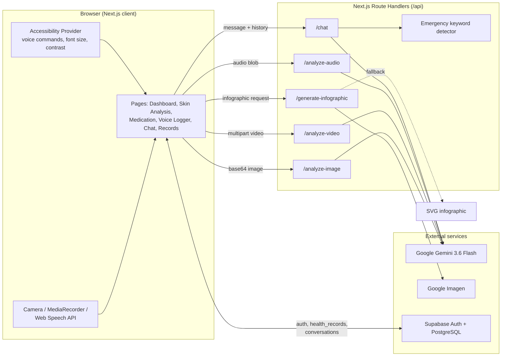

<div align="center">

# CareLens AI

### AI-Powered Accessible Healthcare Companion

A multimodal health assistant built with Next.js and Google Gemini that helps people understand skin concerns, medications, and symptoms through images, video, voice, and chat, designed around accessibility from the start.


</div>

> [!IMPORTANT]
> CareLens AI is a portfolio and research project. Its AI responses are **informational only** and are **not** medical diagnoses. See the [Medical Disclaimer](#13-medical-disclaimer).

---

## Table of Contents

1. [Project Overview](#1-project-overview)
2. [Problem Statement](#2-problem-statement)
3. [Our Solution](#3-our-solution)
4. [Key Features](#4-key-features)
5. [Technology Stack](#5-technology-stack)
6. [System Architecture](#6-system-architecture)
7. [Installation and Setup](#7-installation-and-setup)
8. [Environment Variables](#8-environment-variables)
9. [Running Locally](#9-running-locally)
10. [Screenshots](#10-screenshots)
11. [Accessibility Features](#11-accessibility-features)
12. [Future Enhancements](#12-future-enhancements)
13. [Medical Disclaimer](#13-medical-disclaimer)

---

## 1. Project Overview

CareLens AI is a full-stack web application that combines Google's Gemini multimodal models with an accessibility-focused interface. Users can photograph a skin concern, upload a short video, scan a medication label, describe symptoms by voice, or ask questions in a health chat. Each analysis returns plain-language observations, a confidence level, an urgency classification (Routine / Monitor / Seek Care), and next-step suggestions that always point users toward a healthcare professional.

Signed-in users can save analyses and conversations to a personal health record backed by Supabase (PostgreSQL with Row Level Security).

| | |
| --- | --- |
| **Type** | Full-stack web app (Next.js App Router + API routes) |
| **AI provider** | Google Gemini 3.6 Flash (configurable), with optional Imagen image generation |
| **Data layer** | Supabase Auth + PostgreSQL |
| **Target users** | Older adults, people with visual or motor impairments, and caregivers |

## 2. Problem Statement

- Many health apps rely on dense interfaces, small touch targets, and text-heavy flows, which makes them hard to use for older adults and people with disabilities.
- People often have a quick question ("Is this rash worth seeing someone about?", "What is this pill for?") but no simple, low-friction way to get general information.
- Health notes, symptom descriptions, and AI conversations end up scattered across devices and apps.
- Typing is not always practical; voice and camera input are often more natural.

## 3. Our Solution

CareLens AI gives users several input modes (camera, image upload, video upload, voice, and text) behind one consistent, high-contrast, large-target interface. A server-side Gemini integration turns those inputs into structured, cautious, non-diagnostic guidance, and a keyword-based safety layer flags possible emergencies in chat. Results can be saved to a personal health record or carried into a follow-up conversation with the AI assistant.

## 4. Key Features

### Feature status

| Feature | Status | Where it lives |
| --- | --- | --- |
| AI-powered skin analysis (image) | Implemented | [`app/skin-analysis`](app/skin-analysis/page.tsx), [`app/api/analyze-image`](app/api/analyze-image/route.ts) |
| Multimodal video analysis | Implemented | [`app/api/analyze-video`](app/api/analyze-video/route.ts) |
| Medication scanning | Implemented | [`app/medication`](app/medication/page.tsx) |
| Voice-based symptom logging | Implemented | [`app/voice-logger`](app/voice-logger/page.tsx), [`app/api/analyze-audio`](app/api/analyze-audio/route.ts) |
| AI health chatbot | Implemented | [`app/chat`](app/chat/page.tsx), [`app/api/chat`](app/api/chat/route.ts) |
| Emergency keyword detection in chat | Implemented (rule-based) | [`lib/emergency-intelligence.ts`](lib/emergency-intelligence.ts) |
| AI-generated health infographics | Implemented, with fallback | [`app/api/generate-infographic`](app/api/generate-infographic/route.ts) |
| Health records management | Implemented (requires Supabase) | [`app/health-records`](app/health-records/page.tsx), [`lib/health-records.ts`](lib/health-records.ts) |
| Accessibility toolbar and voice navigation | Implemented | [`components/accessibility-toolbar.tsx`](components/accessibility-toolbar.tsx) |
| Installable PWA manifest | Implemented | [`public/manifest.json`](public/manifest.json) |
| Offline mode / background sync | Experimental, not active | [`public/sw.js`](public/sw.js) exists but is not registered |
| Streaming chat endpoint | Experimental, not used by the UI | [`app/api/live-chat`](app/api/live-chat/route.ts) |
| Scheduled medication reminders | Experimental | Sends a test browser notification only |

### AI-powered skin analysis
Capture a photo with the device camera or upload an image. Gemini returns a visual assessment, possible concerns, a confidence level, an urgency level, and recommendations. The prompt explicitly instructs the model to stay non-diagnostic.

### Multimodal image and video processing
The skin analysis page also accepts short video uploads (MP4, MOV, AVI; up to 25 MB). The video is sent to Gemini with a prompt that looks at movement, posture, gait, and visible skin changes.

### Medication scanning
Photograph a medication label or pill. The assistant describes the likely medication, typical usage, common side effects, interaction notes, and storage guidance, and reminds users to confirm with a pharmacist.

### Voice-based symptom logging
Record a spoken description of symptoms with the browser's `MediaRecorder` API. A live transcript is shown where the Web Speech API is available, and the audio is analyzed by Gemini for key symptoms, emotional tone, urgency, and follow-up questions.

### AI health chatbot
A conversational assistant with conversation history (saved to Supabase when signed in). Results from skin, medication, or voice analysis can be opened directly in chat for follow-up questions. Every message passes through a rule-based emergency detector that surfaces a prominent alert with emergency guidance when it sees high-risk phrases.

### AI-generated health infographics
From the medication page, users can generate a medication schedule, symptom tracker, or health progress infographic. The API tries Google Imagen models in order (`imagen-4.0-generate-001`, then Imagen 3.0) and falls back to a locally generated SVG infographic if image generation is unavailable for the API key.

### Health records management
Signed-in users can view, search, filter by type, delete, and export (JSON) their saved skin analyses, voice logs, medication scans, and chat sessions.

### Progressive Web App
The app ships a web app manifest with shortcuts (Emergency Chat, Skin Analysis, Health Records), so it can be installed from supported browsers. An offline page and service worker are included in `public/` but the service worker is not yet registered, so offline caching is not active today.

## 5. Technology Stack

| Layer | Technologies |
| --- | --- |
| Framework | Next.js 15 (App Router, Route Handlers), React 19, TypeScript |
| Styling and UI | Tailwind CSS 4, Radix UI primitives, shadcn/ui-style components, Lucide icons |
| AI | `@google/generative-ai` SDK with Gemini 3.6 Flash (falls back to 3.5 Flash-Lite on temporary 429/503 errors); Imagen via the Generative Language REST API |
| Browser APIs | MediaDevices (camera), MediaRecorder, Web Speech API (recognition + synthesis), Notifications |
| Auth and data | Supabase Auth, Supabase PostgreSQL with Row Level Security ([`supabase-schema.sql`](supabase-schema.sql)) |
| Forms and validation | React Hook Form, Zod |
| Analytics | Vercel Analytics |
| Deployment | Docker (standalone Next.js output), Google Cloud Run via [`cloudbuild.yaml`](cloudbuild.yaml) / [`deploy.sh`](deploy.sh) |

## 6. System Architecture



**Request flow:** the client captures media, encodes it, and calls a Route Handler. The handler adds a task-specific prompt from [`lib/gemini.ts`](lib/gemini.ts), calls Gemini on the server (so the API key never reaches the browser), and parses the reply into confidence, urgency, and recommendations. The client renders the result and, for signed-in users, saves it to Supabase.

**Project structure**

```text
app/
  api/                 Route Handlers (Gemini, Imagen, health check)
  auth/callback/       Supabase auth redirect handler
  chat/ health-records/ medication/ skin-analysis/ voice-logger/
components/            Accessibility, auth, camera, recorder, UI primitives
hooks/                 Speech, voice commands, keyboard navigation, push notifications
lib/                   Gemini prompts, API client, Supabase, health records, emergency detection
public/                Manifest, service worker, offline page, icons
supabase-schema.sql    Database tables, RLS policies, and triggers
```

## 7. Installation and Setup

### Prerequisites

- Node.js 20 or newer
- npm (the project's lockfile is `package-lock.json`)
- A [Google AI Studio](https://aistudio.google.com/) API key
- A [Supabase](https://supabase.com/) project (for sign-in and health records)

### 1. Clone and install

```bash
git clone https://github.com/acorn266/CareLens-AI.git
cd CareLens-AI
npm install
```

### 2. Configure environment variables

```bash
cp .env.example .env.local
```

Then fill in the values described in [Environment Variables](#8-environment-variables).

### 3. Set up the database

1. Open your Supabase project and go to **SQL Editor**.
2. Paste and run the contents of [`supabase-schema.sql`](supabase-schema.sql). It creates the `profiles`, `health_records`, `conversations`, `medications`, and `medication_logs` tables with Row Level Security policies.
3. Under **Authentication > URL Configuration**, add `http://localhost:3000/auth/callback` (and your production URL) as a redirect URL.

## 8. Environment Variables

| Variable | Required | Scope | Description |
| --- | --- | --- | --- |
| `GOOGLE_AI_API_KEY` | Yes | Server | Google AI Studio key used for Gemini and Imagen |
| `GEMINI_MODEL` | Optional | Server | Overrides the Gemini model (default `gemini-3.6-flash`). On a temporary 429/503 the app retries once with `gemini-3.5-flash-lite` |
| `NEXT_PUBLIC_SUPABASE_URL` | Yes | Client + server | Your Supabase project URL |
| `NEXT_PUBLIC_SUPABASE_ANON_KEY` | Yes | Client + server | Supabase anonymous (public) key |
| `NEXT_PUBLIC_SITE_URL` | Recommended | Client + server | Base URL for auth redirects, for example `http://localhost:3000` |
| `GCP_PROJECT_ID` | Optional | Scripts | Used by `scripts/setup-gcp.js` for Cloud Run setup |
| `CUSTOM_KEY` | Optional | Build | Passed through `next.config.mjs`; not used by app code |

`.env.local` is git-ignored. Only [`.env.example`](.env.example), which contains placeholders, is committed.

## 9. Running Locally

```bash
# Development server at http://localhost:3000
npm run dev

# Production build and start
npm run build
npm start

# Lint
npm run lint

# Check the API is up and the Gemini key is configured
curl http://localhost:3000/api/health
```

Camera and microphone access require a secure context. `localhost` works for development; deployed instances must use HTTPS.

### Docker

```bash
docker build -t carelens-ai \
  --build-arg NEXT_PUBLIC_SUPABASE_URL=... \
  --build-arg NEXT_PUBLIC_SUPABASE_ANON_KEY=... \
  --build-arg GOOGLE_AI_API_KEY=... .
docker run -p 3000:3000 carelens-ai
```

For Google Cloud Run, see [`deploy.sh`](deploy.sh) and [`cloudbuild.yaml`](cloudbuild.yaml).

## 10. Screenshots

> Screenshots will be added to [`docs/screenshots/`](docs/screenshots/). The placeholders below show what each one will cover.

| Screen | Preview |
| --- | --- |
| Dashboard | _Screenshot coming soon_ (`docs/screenshots/dashboard.png`) |
| Skin analysis result | _Screenshot coming soon_ (`docs/screenshots/skin-analysis.png`) |
| Video analysis | _Screenshot coming soon_ (`docs/screenshots/video-analysis.png`) |
| Medication scanner | _Screenshot coming soon_ (`docs/screenshots/medication-scanner.png`) |
| AI health infographic | _Screenshot coming soon_ (`docs/screenshots/infographic.png`) |
| Voice symptom logger | _Screenshot coming soon_ (`docs/screenshots/voice-logger.png`) |
| Health chat with emergency alert | _Screenshot coming soon_ (`docs/screenshots/chat.png`) |
| Health records | _Screenshot coming soon_ (`docs/screenshots/health-records.png`) |
| Accessibility toolbar | _Screenshot coming soon_ (`docs/screenshots/accessibility-toolbar.png`) |

## 11. Accessibility Features

Accessibility shaped the interface from the start. The features below are implemented; the app has **not** been formally audited against WCAG.

| Feature | Details |
| --- | --- |
| Floating accessibility toolbar | Available on every page |
| Adjustable text size | 100% to 300% in 25% steps, saved per browser |
| High-contrast mode | Toggle from the toolbar, saved per browser |
| Voice navigation | Spoken commands to move between pages (Web Speech API); start with the mic button or <kbd>Ctrl</kbd>/<kbd>Cmd</kbd> + <kbd>Space</kbd> |
| Wake word | Optional "Hey CareLens" listening mode |
| Text-to-speech feedback | Actions and results can be read aloud |
| Keyboard navigation | Arrow keys, <kbd>Enter</kbd>/<kbd>Space</kbd>, <kbd>Escape</kbd>, and <kbd>Tab</kbd> handling, plus a "Skip to main content" link |
| Screen reader support | Live-region announcements and ARIA labels on interactive controls |
| Large touch targets | Dedicated `touch-target` sizing for primary actions |

Voice features depend on browser support for the Web Speech API (best in Chromium-based browsers).

## 12. Future Enhancements

- Register the existing service worker to enable offline caching and background sync
- Scheduled medication reminders backed by the `medications` and `medication_logs` tables
- Switch the chat UI to the streaming `/api/live-chat` endpoint
- Automated tests (unit tests for parsing and emergency detection, end-to-end tests for core flows)
- A formal accessibility audit with assistive-technology users
- Multi-language support
- A professionally designed app icon (the current PNG icons are rendered from `public/icon.svg`) and PWA store screenshots

## 13. Medical Disclaimer

CareLens AI is an educational and portfolio project. It is **not** a medical device and has not been clinically validated or reviewed by any regulatory body.

- AI-generated responses are **informational only** and may be incomplete or wrong. They are not medical diagnoses, treatment plans, or professional medical advice.
- Confidence and urgency labels come from the language model's own output and are not clinically calibrated.
- Emergency detection is a simple keyword and threshold check and can miss real emergencies.
- Always consult a qualified healthcare professional about medical concerns. **In an emergency, call your local emergency number (for example 911 in the US) right away.**
- The project has not been assessed for HIPAA or any other healthcare compliance standard. Do not use it to store real patient data without your own security and compliance review.
